# Дрон MČR 2026 — v2: что изменено относительно v1

Замечание оператора к v1: «дрон норм, но одна полоса криво идёт через дорожку».
Всё остальное в v1 утверждено. Камера, свет, грейд, шейдеры и тайминг в v2 те же; изменено только то, что описано ниже.

## Что это было

Это провода ЛЭП, впечатанные в ортофото ČÚZK (0,125 м/px). Воздушная линия идёт через сцену с северо-запада на юго-восток: от опоры P1 (UTM ≈ 461254 / 5584829) через луг, через гравийную дорожку, по насыпи между Malý Sporťáček и выростными прудами, дальше через лес и дорогу I/9 к опоре P4 (≈ 461820 / 5584532). На ортофото это 3–4 тонкие светлые линии.

«Криво» получается из-за шва мозаики ортофото: он проходит прямо вдоль гравийной дорожки. Провода висят высоко, и на двух исходных аэроснимках они сняты под разными углами. Поэтому на шве весь пучок проводов сдвигается вбок примерно на 3 м. В пролёте это видно как полоса, которая пересекает дорожку и на ней ломается.

Рельеф (DSM) под проводами чистый: высота над землёй около 0 м, ни стенки, ни выброса нет. То есть дефект только в текстуре. Ещё одно место, где провода были видны: карта рельефа крон `crown_det_025.png`. Она строится из яркости ортофото, поэтому над лесом провода давали гребень 1–2 м по линии ЛЭП.

### До (v1)

Кадр v1 f080, увеличение ×2: провода пересекают дорожку, справа и слева от неё они на разной высоте.
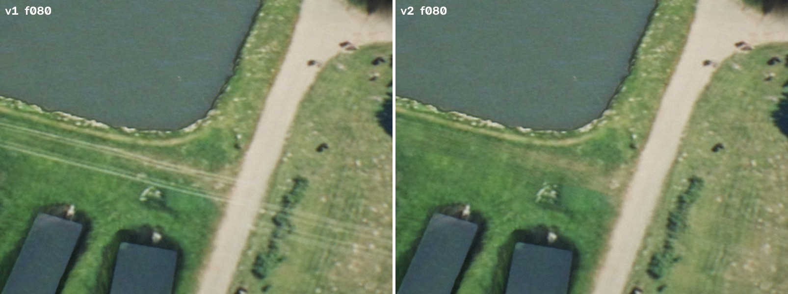

Ортофото v1 у дорожки:
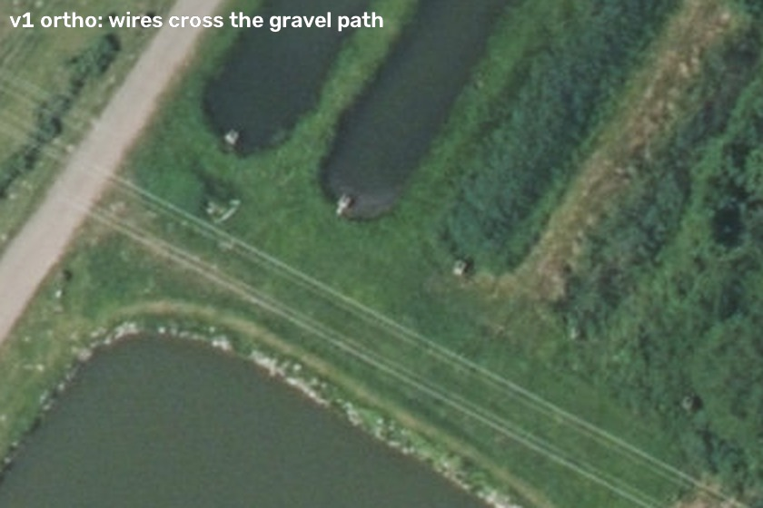

Ортофото развёрнуто вдоль линии ЛЭП. На дорожке (шов мозаики) пучок проводов прыгает примерно на 3 м:
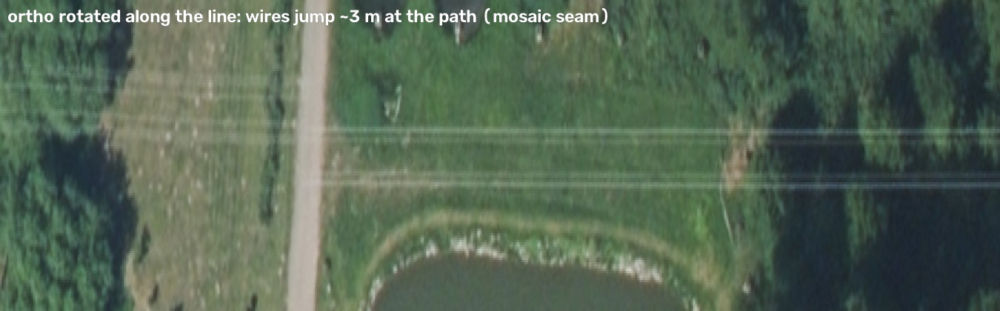

## Что сделано (правка в исходных данных)

1. **`mesh/py/clean_wires.py`** — новый скрипт, убирает провода из `data/orto_core_6400.jpg`. Как он работает:
   - каждый пролёт между опорами разворачивается в полосу, где провода лежат горизонтально;
   - детектор тонких светлых линий собирает пики в цепочки длиной не меньше 40 м, прямые, достаточно контрастные; обычная фактура этим условиям не отвечает;
   - цепочки продлеваются через участки с низким контрастом: кусты и шов на дорожке;
   - маска = ±2 px вокруг каждого провода;
   - заливка: Telea-inpaint даёт низкие частоты, а зерно (high-pass) берётся с соседней полосы в 7 px сбоку. Поэтому трава, гравий и кроны в залитом месте сохраняют свою фактуру, без «мыла»;
   - нужно 2 прохода, второй уже ничего не находит.

   Результат: `data/orto_core_6400_nowires.png` (без потерь). Изменено 0,35 % пикселей, все внутри маски `data/orto_core_6400_wiremask.png`; это проверяется assert в скрипте. Отчёт: `data/orto_core_6400_nowires.json`. Исходный JPEG не тронут.
   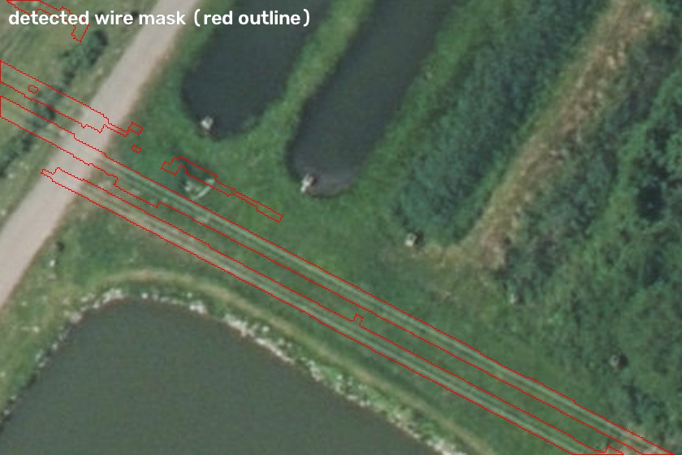
   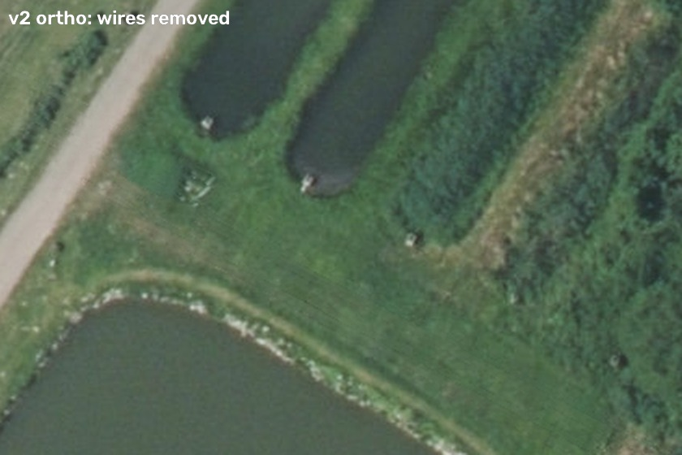
   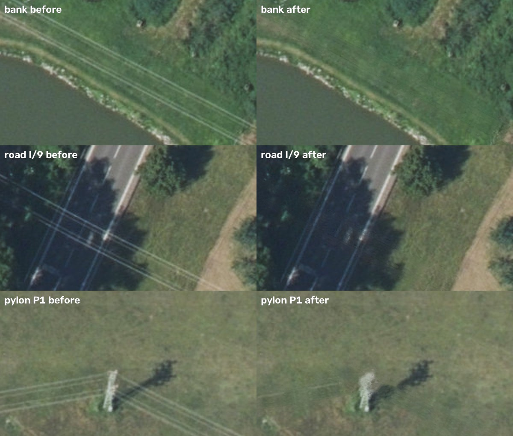
2. **`mesh/py/preprocess.py`**: карта крон `crown_det` теперь строится из очищенного ортофото (`ORTHO_DET`, по умолчанию `orto_core_6400_nowires.png`). Повторный прогон preprocess на старом ортофото даёт build/ побайтно как v1. С новым ортофото меняется только `build/crown_det_025.png`, и только в полосе ±7,5 м от проводов (вне её 3 пикселя на ±1). Старый файл сохранён как `build/crown_det_025_v1.png`.
   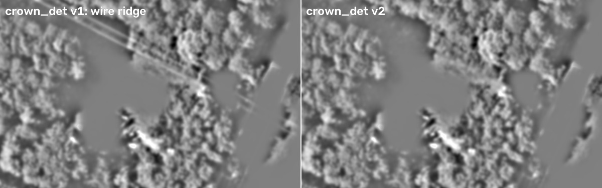
3. **`mesh/src/scene.js`**: основное ортофото теперь `orto_core_6400_nowires.png`. Через `--ortho=orto_core_6400.jpg` можно воспроизвести v1.
   **`mesh/src/render.mjs`**: добавлены ключи `--ortho=` и `--out=` (папка для mp4 и стоп-кадров).
4. **Шейдеры v1.** Утверждённый v1 9:16 был отрендерен шейдерами до «pass-2» (`mesh/tmp/shaders_v1.js`). Проверка: этим набором кадр v1 f110 воспроизводится с maxdiff 1. После v1 в `src/shaders.js` попал «pass-2»: листва на опушках, свет крон, небо чуть синее. Оператор его не видел, поэтому `src/shaders.js` возвращён к версии v1, а pass-2 сохранён в `mesh/tmp/shaders_pass2.js`.

## Проверка

- Сырые кадры v2 9:16 сравнены с кадрами v1 (рендер детерминирован). Разница есть только вдоль коридора ЛЭП: провода на насыпи, на лугу и на опушке. Пикселей с разницей больше 3/255: f000 — 11 004, f040 — 11 644, f080 — 22 943, f110 — 32 660 (это 0,5–1,6 % кадра). Остальной кадр совпадает.
- Ещё раз прогнан детектор длинных тонких прямых линий по всему очищенному ортофото. Остались только настоящие объекты: ряды в поле, разметка I/9, заборы и края участков. Других проводов и швов нет.

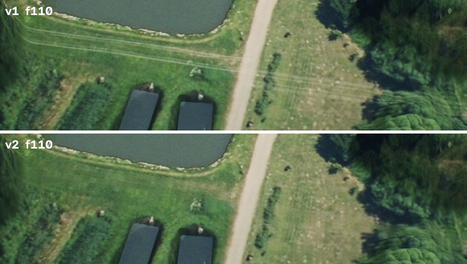
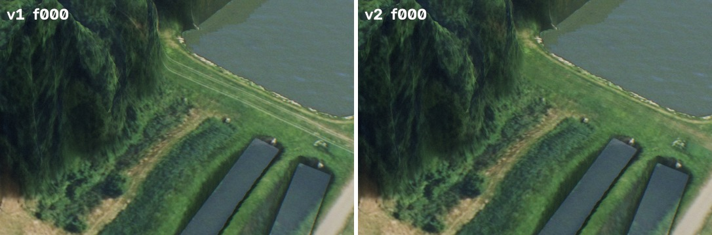
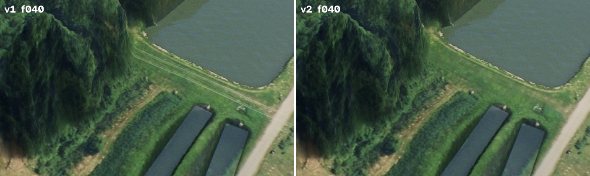

16:9 v2 (в v1 не было готового 16:9):
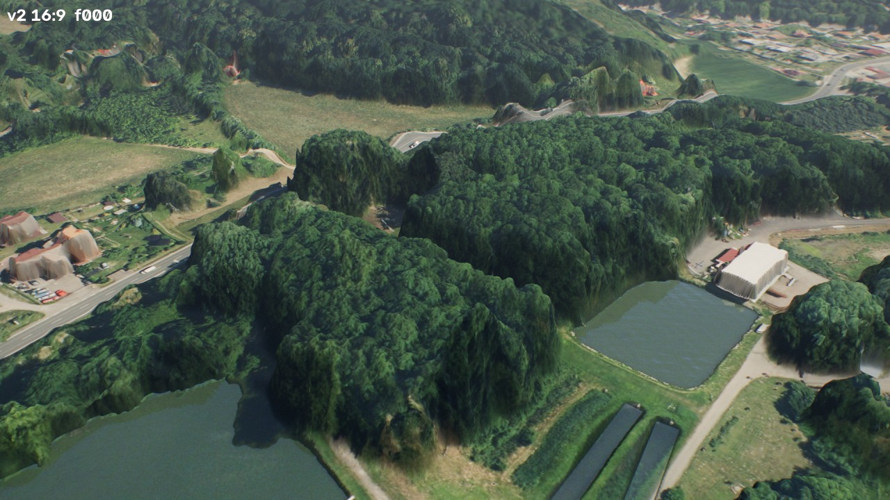
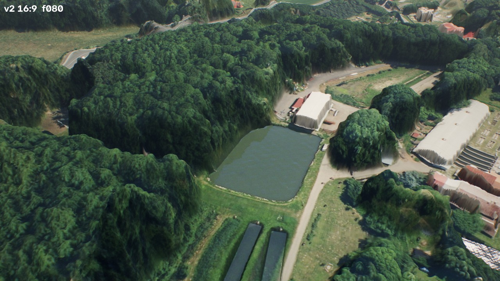
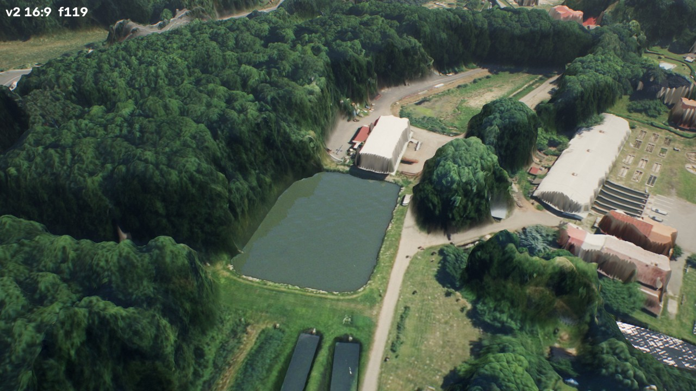

### Что видно, но не тронуто (часть утверждённого вида)

- Стены цеха líheň выглядят как «занавес» (вертикальные полосы штукатурки в шейдере).
- Серая плоскость под большим деревом справа от дорожки (f100–f119). Это крыша сарая (UTM ≈ 461398 / 5584702): она лежит на краю кроны, и цвет крыши вытягивается на крутой склон кроны.

- В 16:9 кадр шире, поэтому по краям (f060–f119, справа) видно больше построек деревни с такими же «стенами-занавесами» и плёночные крыши у líheň. В 9:16 их нет; оператор 16:9 ещё не видел.

Все эти места — это стиль шейдера, а не ошибка данных. Чтобы их исправить, пришлось бы менять общий вид всех стен и опушек, поэтому их оставили. Если нужно, правятся отдельно.

## Как пересобрать

`nowires.png` и `build/` в git не хранятся. Скрипт детерминирован: повторный прогон дал те же пиксели.

```
python3 mesh/py/clean_wires.py   # ~1 мин -> data/orto_core_6400_nowires.png (+ mask, json)
python3 mesh/py/preprocess.py    # build/ (меняется только crown_det_025.png)
```

## Рендер v2

- 4,0 с, 30 fps, 120 кадров, ss 2, sub 2, refl 0,5, H.264 CRF 16 yuv420p bt709 — как v1.
- `out/v2/flyover_9x16.mp4` (1080×1920) и `out/v2/flyover_16x9.mp4` (1920×1080), стоп-кадры f000/f040/f080/f119 для обоих.
- Финальные файлы: `final/flyover_9x16.mp4`, `final/flyover_16x9.mp4`.
- Команды:
  - `node src/render.mjs --aspect=9x16 --ss=2 --sub=2 --refl=0.5 --tag=9x16_v2 --stills=0,40,80,119 --encode --out=out/v2`
  - то же самое с `--aspect=16x9 --tag=16x9_v2`.
